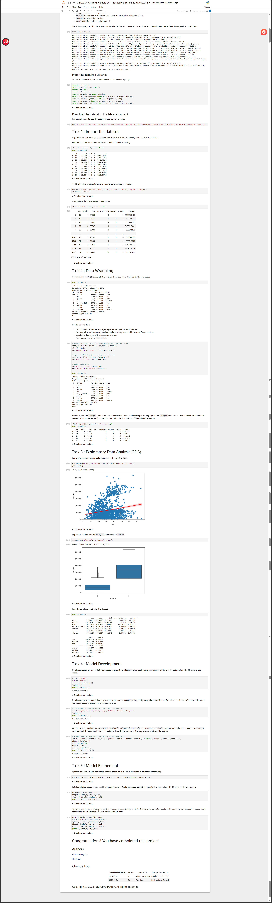
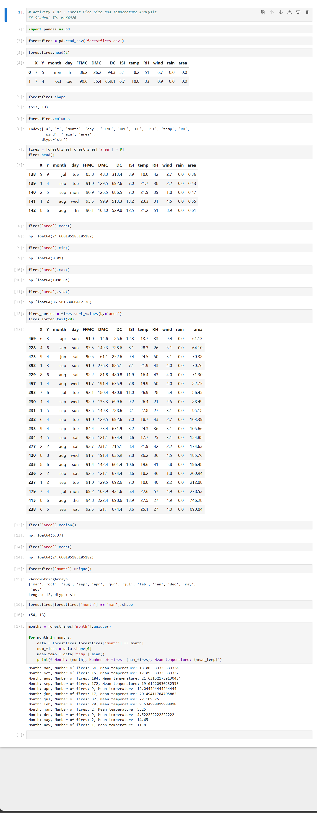

# CISC7204D Data Science Project

## 1. The problem or research question
This project investigates two real-world datasets: (1) House Sales in King County, USA, to build a predictive model for house prices based on property features, and (2) Forest Fire Size and Temperature Analysis, to explore the relationship between meteorological conditions and fire burned area. The main research question is: How can we accurately predict housing prices using regression models, and what are the key environmental factors influencing forest fire size?

## 2. Dataset source and usage permissions
- **Source:** Both datasets are provided by the course instructor (CISC7204) for educational purposes.
- **Usage Permissions:** The datasets are used solely for academic learning and completion of this assignment.

## 3. Methods and tools used
- **Tools:** Python, Jupyter Notebook, Pandas, NumPy, Matplotlib, Seaborn, Scikit-learn.
- **Methods:** Data cleaning (handling missing values, data transformation), Exploratory Data Analysis (EDA), Linear Regression, Ridge Regression, Polynomial Transformation, and Model Evaluation (R-squared, RMSE).

## 4. Key findings and one limitation
- **Key findings:** For the house price prediction, the polynomial regression model with Ridge regularization showed the best performance, suggesting that non-linear relationships exist between features and prices. For the forest fire dataset, the month of August and September had the highest number of fire occurrences, and a weak correlation was observed between temperature and burned area.
- **Limitation:** A significant limitation is the presence of outliers and missing values in the datasets, which may affect the model's generalization ability. Additionally, the forest fire dataset shows high variance in fire size, making accurate prediction challenging.

## 5. Instructions for running the analysis
1. Clone this repository to your local machine.
2. Open the Jupyter Notebook `cisc7204D_Assgn01_Mod06FinalProject_mc64920.ipynb`.
3. Run all cells in the notebook to reproduce the analysis and visualizations.

## Visualizations

